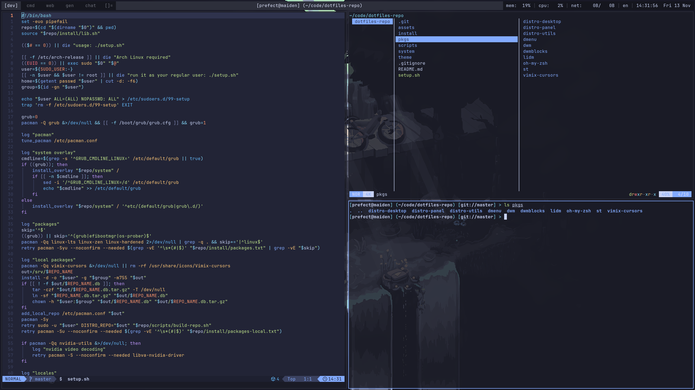
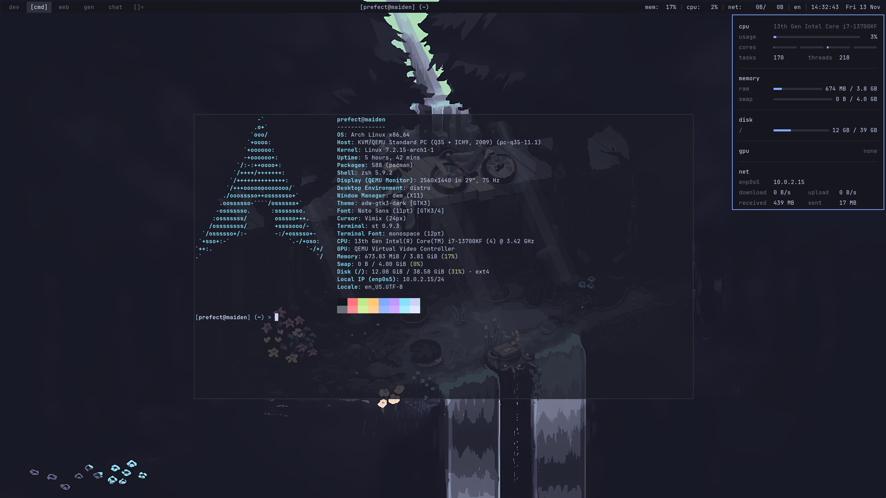
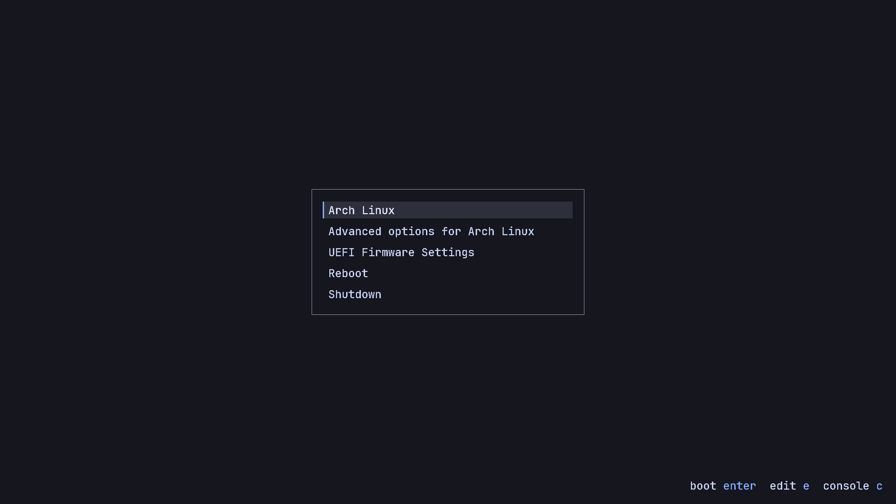

# dotfiles

A personal Arch Linux desktop built around dwm



## Install

```sh
git clone https://github.com/PrefectSol/dotfiles-repo.git
cd dotfiles-repo
./setup.sh
reboot
```

## Included

dwm · st · dmenu · clipboard · dwmblocks · lidm · grub · firefox · nvim · zsh · miniforge · yazi · picom · dunst · flameshot · fastfetch




