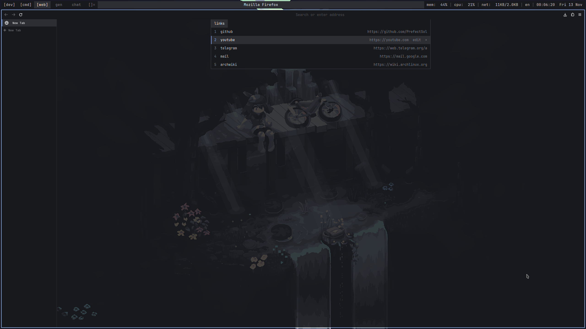

# dotfiles

A personal Arch Linux desktop built around dwm: X11, no animations, one shared palette.


## Requirements

- x86_64 machine with UEFI
- Internet connection during install

## Install

**1. Base system.** Boot the official Arch ISO, connect to the network (`iwctl` for Wi-Fi), run `archinstall` and pick:

| Option | Choice |
|---|---|
| Mirrors | your region |
| Locales | keyboard `us`, language `en_US.UTF-8` |
| Disk | best-effort layout, ext4 (encryption optional) |
| Bootloader | GRUB (gets the theme; systemd-boot also works) |
| Swap | zram (default) |
| Authentication | root password, a user with sudo |
| Profile | Minimal |
| Audio | none (PipeWire is installed by `setup.sh`) |
| Kernel | linux |
| Network | NetworkManager |
| Additional packages | `git` |
| Timezone | yours |

Install, reboot, log in as your user.

**2. Desktop.**

```sh
git clone https://github.com/PrefectSol/dotfiles-repo.git
cd dotfiles-repo
./setup.sh            # add --conda to install Miniforge to /opt/conda
reboot
```

`setup.sh` installs the packages, builds the local `[distro]` repository into `/srv/distro`, applies the system config and switches the login to lidm. Run it again later to rebuild and update. GPU drivers beyond Mesa (e.g. NVIDIA) are not installed.

## What's customized

- **dwm**: splits the focused window along its longer side, independent layouts per tag and monitor, gaps, centered title, resize from 8 points, restart keeps the full state, double-click a tag to open a terminal
- **st**: 0.8 transparency, 100k-line scrollback on the wheel, clickable links, cursor takes the color of the text under it
- **dmenu**: drawn over the bar, fuzzy matching with highlighted letters, launch history
- **clipboard**: own clipmenu with text, images and files, a preview pane, history that survives reboots
- **bar**: dwmblocks with C helpers for mem / cpu / net / layout / clock; click a block to open the system or date panel, with draggable volume sliders
- **lidm**: login manager fork, plus a GRUB theme in the same style
- **Firefox**: vertical tabs, a stripped-down square UI, a new-tab page with links you edit in place, translucent page area, telemetry off
- **nvim**: LazyVim
- **zsh**: oh-my-zsh, a one-line prompt, `cd ...` goes up two levels
- **yazi**, **picom**, **dunst**, **flameshot**, **fastfetch**
- **palette**: one source, `theme/palette`, shared by the console, GRUB, lidm, terminal, bar and menus

## Keys

| | |
|---|---|
| `Super+Enter` | terminal |
| `Super+Space` | launcher |
| `Super+V` | clipboard |
| `Super+S` / `Super+D` | system / date panel |
| `Super+1..5` | tags |
| `Super+Q` | close window |
| `Super+Shift+R` | restart dwm |
| `Print` | screenshot |



